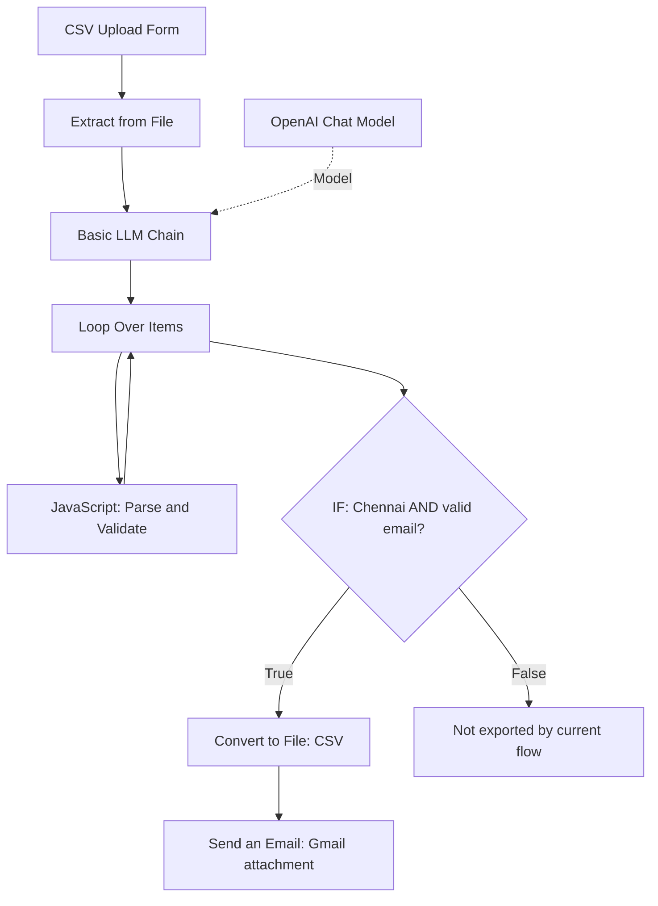

# AI Automation with n8n and Python

**Practical ETL automation, AI-assisted data cleaning, automated email delivery, and chat-based AI assistants**

This repository demonstrates an end-to-end student-enrollment CSV workflow using [n8n](https://n8n.io/) and a planned equivalent implementation using Python and Pandas.

The n8n workflow accepts a CSV upload, extracts rows, uses an LLM-assisted transformation step, parses and validates the result with JavaScript, filters records, generates a CSV file, and sends the generated file as an email attachment through Gmail.

It also includes a Slack-native AI assistant built with n8n: the **Slack Recipe Bot** turns a dish name typed in a channel into an ingredient list, posted back in the same channel.

> **Scope note:** The n8n workflow is the primary demonstrated implementation. The Python/Pandas implementation is a companion implementation to be completed and tested separately. Screenshots, exported workflow JSON, and output samples should be added only after they have been checked and sanitized.

## Projects

| Project | What it does | Stack | Details |
|---|---|---|---|
| Student enrollment ETL | CSV upload, AI-assisted cleaning, validation and filtering, CSV output, Gmail delivery | n8n, OpenAI, JavaScript, Gmail | [Sections below](#project-at-a-glance), [docs 01-06](#documentation) |
| Slack Recipe Bot | Dish name in Slack, LLM-generated ingredient list, reply in the same channel | n8n, Slack Events API, OpenAI | [Slack Recipe Bot](#slack-recipe-bot), [docs 07-10](#documentation) |

## Project at a glance

- **Input:** Student-enrollment CSV uploaded through an n8n form.
- **Processing:** CSV extraction, AI-assisted normalization, JavaScript parsing and validation, and conditional filtering.
- **Business rule:** Export records where `City = Chennai` and the email address passes the configured validation rule.
- **Output:** A generated CSV that can be downloaded from the n8n execution output.
- **Delivery:** Gmail sends the generated CSV as an attachment.
- **Hosting options:** Local Windows n8n, self-hosted n8n on a VPS, or n8n Cloud.

## Workflow overview



The diagram summarizes the workflow visible in the working execution screenshot. The precise loop wiring and node settings should be verified against the exported n8n workflow before publication.

## Key features

- CSV ingestion through an n8n form.
- AI-assisted data normalization using an LLM.
- JavaScript parsing of the LLM response into structured fields.
- Deterministic email-format validation and conditional filtering.
- CSV generation for accepted records.
- Gmail delivery with the generated CSV attached.
- A companion Python/Pandas ETL design.
- Documentation of local, VPS self-hosted, and managed cloud deployment choices.
- A Slack chat assistant with a webhook-based trigger, loop protection, an LLM chain, and graceful handling of unclear input.

## Repository structure

```
ai-automation-n8n-python/
├── README.md
├── .gitignore
├── LICENSE
├── docs/
│   ├── 01-automation-fundamentals.md
│   ├── 02-n8n-etl-workflow.md
│   ├── 03-python-pandas-etl.md
│   ├── 04-ai-vs-rule-based-cleaning.md
│   ├── 05-n8n-deployment-options.md
│   ├── 06-testing-and-data-quality.md
│   ├── 07-slack-recipe-bot-architecture.md
│   ├── 08-slack-recipe-bot-workflow-design.md
│   ├── 09-slack-recipe-bot-setup-and-operations.md
│   └── 10-slack-recipe-bot-troubleshooting.md
├── images/
│   ├── n8n-architecture-deployment-options.png
│   ├── n8n-student-enrollment-etl.png
│   ├── slack-recipe-bot-architecture.png
│   ├── slack-recipe-bot-workflow.png
│   ├── slack-recipe-bot-sequence.png
│   └── slack-recipe-bot-input-handling.png
├── flows/n8n/
│   └── slack-recipe-bot.json
├── python/
│   ├── README.md
│   ├── requirements.txt
│   ├── src/
│   ├── data/
│   └── tests/
└── evidence/
    ├── n8n-execution/
    ├── output-samples/
    └── slack-recipe-bot/
        ├── README.md
        ├── n8n-workflow-canvas.png
        └── slack-ingredient-list-reply.png
```

## Documentation

1. [Automation fundamentals and ETL concepts](docs/01-automation-fundamentals.md)
2. [n8n workflow walkthrough](docs/02-n8n-etl-workflow.md)
3. [Python and Pandas ETL companion](docs/03-python-pandas-etl.md)
4. [AI-assisted versus rule-based cleaning](docs/04-ai-vs-rule-based-cleaning.md)
5. [n8n deployment options](docs/05-n8n-deployment-options.md)
6. [Testing and data quality](docs/06-testing-and-data-quality.md)
7. [Slack Recipe Bot: architecture](docs/07-slack-recipe-bot-architecture.md)
8. [Slack Recipe Bot: workflow design](docs/08-slack-recipe-bot-workflow-design.md)
9. [Slack Recipe Bot: setup and operations](docs/09-slack-recipe-bot-setup-and-operations.md)
10. [Slack Recipe Bot: troubleshooting](docs/10-slack-recipe-bot-troubleshooting.md)

## Quick start: n8n workflow

1. Open the n8n instance where the workflow is configured.
2. Upload a student-enrollment CSV through the form.
3. Run the workflow and inspect the node execution status.
4. Check the IF node's true and false branch counts.
5. Inspect the generated CSV from the `Convert to File` node output.
6. Confirm that the Gmail node successfully sends the attachment to the intended recipient.

The workflow export is not included yet. Export the workflow from n8n, review the JSON for secrets and personal information, then place the sanitized file in `flows/n8n/`.

## Business rule

A record is included in the output only when both conditions are true:

- The normalized city value is `Chennai`.
- The email address passes the configured email-format check.

This is a basic syntax check, not proof that an email inbox exists or can receive mail.

## AI and data integrity

An LLM can produce plausible but incorrect data. Valid JSON does not guarantee factual correctness. Preserve source identifiers, validate transformed values with code, and compare output fields with the original row when accuracy matters. For fixed transformations, deterministic code may be preferable to an LLM because it is easier to test and generally more predictable.

## n8n Deployment Options

The best deployment depends on whether you are prototyping, running persistent workflows, or prefer a managed platform.

[](images/n8n-architecture-deployment-options.png)

| Deployment                               | Advantages                                                                                                                                          | Key considerations                                                                                                                                                | When to choose                                                                                                        |
| ---------------------------------------- | --------------------------------------------------------------------------------------------------------------------------------------------------- | ----------------------------------------------------------------------------------------------------------------------------------------------------------------- | --------------------------------------------------------------------------------------------------------------------- |
| **Local n8n (Windows, macOS, or Linux)** | Easy to set up; ideal for prototyping, testing, and experimenting; direct control over your local environment.                                      | Your computer must be powered on, awake, connected, and the n8n process must be running for workflows to execute. Local resources and network access also matter. | Personal prototyping, development, debugging, and small non-critical workflows.                                       |
| **Self-hosted n8n on a VPS**             | Runs independently of your personal computer; offers control over configuration and integrations; can support persistent workflows and team access. | You are responsible for server setup, security, updates, backups, monitoring, storage, and availability. Actual uptime depends on the provider and configuration. | Long-running or production workflows, controlled team access, and integrations that benefit from a server you manage. |
| **n8n Cloud**                            | Managed hosting; less server maintenance; convenient setup and collaboration; infrastructure is managed by n8n.                                     | Subscription pricing, plan limits, supported features, and data-handling requirements should be reviewed for your use case.                                       | Teams that want a managed solution and prefer not to administer a server.                                             |

**Local execution reminder:** If your PC shuts down, sleeps in a way that stops the process/network, loses connectivity, or n8n stops, workflows generally cannot execute during that interruption. Do not assume missed scheduled executions will automatically replay.

See [deployment options](docs/05-n8n-deployment-options.md) for additional setup and security considerations.

## Security and privacy

- Never commit API keys, OAuth tokens, passwords, `.env` files, or unredacted credentials.
- Sanitize exported n8n workflow JSON before committing it.
- Use synthetic or anonymized student data in public examples.
- Confirm that the recipient address and attachment are correct before enabling automatic email delivery.
- Follow applicable data-protection and organizational policies.

## Current status

- [x] n8n CSV upload and extraction
- [x] LLM-assisted transformation step
- [x] JavaScript parsing and validation
- [x] Conditional Chennai + valid-email filtering
- [x] CSV conversion
- [x] Gmail email with attachment
- [x] Slack Recipe Bot: Slack Events API webhook trigger
- [x] Slack Recipe Bot: loop protection for bot and system messages
- [x] Slack Recipe Bot: LLM-generated ingredient lists replied in the same channel
- [x] Slack Recipe Bot: graceful handling of greetings and unrecognisable input

## Implemented n8n Workflow

The workflow automates CSV ingestion, AI-assisted transformation,
JavaScript validation, conditional filtering, CSV generation,
and email delivery through Gmail.

[](images/n8n-student-enrollment-etl.png)

## Slack Recipe Bot

A chat assistant that lives entirely inside Slack. A user types a dish name in a channel, an LLM works out the products and ingredients needed to make it, and the bot replies with the list in the same channel.

```text
You:  Paneer Butter Masala
Bot:  • Paneer – 400 grams (cubed)
      • Butter – 4 tablespoons
      • Onion – 2 medium (finely chopped)
      • Tomatoes – 4 large (pureed)
      • ...
```


### How it works

1. A user posts a message in a public channel the bot has joined.
2. Slack's Events API sends a `message.channels` event to the n8n webhook (Slack Trigger node).
3. An **If** node lets only human messages through (`bot_id` and `subtype` empty), which prevents the bot from answering itself.
4. **Edit Fields** captures the recipe name and the channel ID.
5. A **Basic LLM Chain** with an OpenAI chat model (`gpt-4o-mini`) applies ordered response rules and returns the answer.
6. The **Slack** node posts the reply to the originating channel.


### Behaviour

| Input | Reply |
|---|---|
| A dish name, for example `Paneer Butter Masala` | Bulleted ingredient list with approximate quantities for 4 servings, formatted for Slack |
| A greeting or very short text, for example `hello` | Asks which recipe or dish to list ingredients for |
| Gibberish or a non-dish word | Polite retry message with an example dish name |
| A message posted by the bot, a join, a file share | Ignored by the `If` node |


### Technology

| Area | Choice |
|---|---|
| Orchestration | n8n (self-hosted on a VPS, published workflow) |
| Chat platform | Slack app with a bot user, Events API (`message.channels`), scopes `channels:history`, `channels:read`, `chat:write` |
| LLM | OpenAI `gpt-4o-mini` through the OpenAI Chat Model node and Basic LLM Chain |
| Secrets | Slack bot token and OpenAI API key held in n8n credentials |

### Design highlights

- **Webhook-based Slack trigger** with Socket Mode off, verified Request URL, and separate Test and Production URLs.
- **Loop protection** before any model call, so the bot's own replies and system messages cost nothing and cannot cause a feedback loop.
- **Prompt-level response rules** for three outcomes: an ingredient list, a request for the dish name, and a retry message.
- **Slack-native formatting** produced directly by the prompt (single-asterisk bold and bullet characters), so no extra formatting node is needed.
- **Channel ID carried through the workflow** so the answer always goes back to where the question was asked.

### Slack Recipe Bot documentation

- [Architecture](docs/07-slack-recipe-bot-architecture.md)
- [Workflow design](docs/08-slack-recipe-bot-workflow-design.md)
- [Setup and operations](docs/09-slack-recipe-bot-setup-and-operations.md)
- [Troubleshooting](docs/10-slack-recipe-bot-troubleshooting.md)
- Exported workflow: [`flows/n8n/slack-recipe-bot.json`](flows/n8n/slack-recipe-bot.json)

### Limitations

- Ingredient quantities are generated by a language model and are approximate. They are not nutritional or allergy guidance.
- Unclear-input handling is prompt-based, so it is reliable in practice but not a hard guarantee.
- Every human message in the watched channel is processed, so a dedicated channel keeps cost and noise down.

## License

See [LICENSE](LICENSE). Replace the suggested license with the one appropriate for your intended reuse and organizational requirements.
