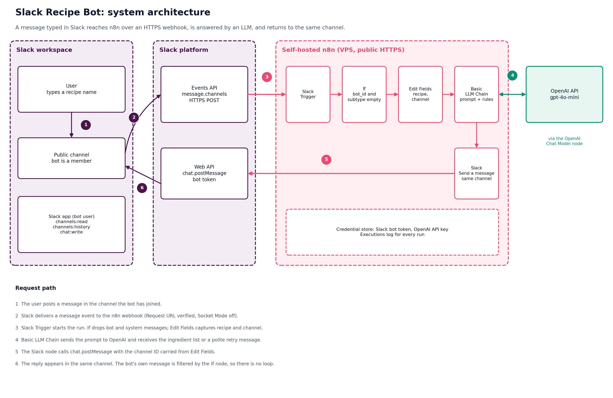
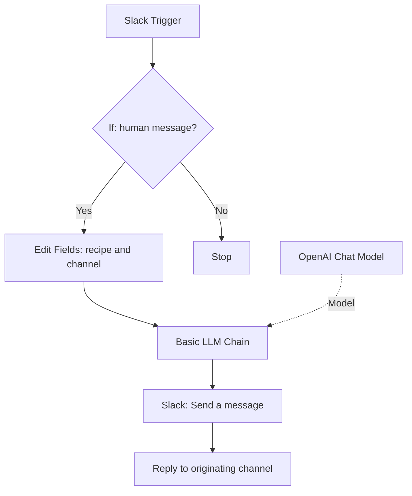
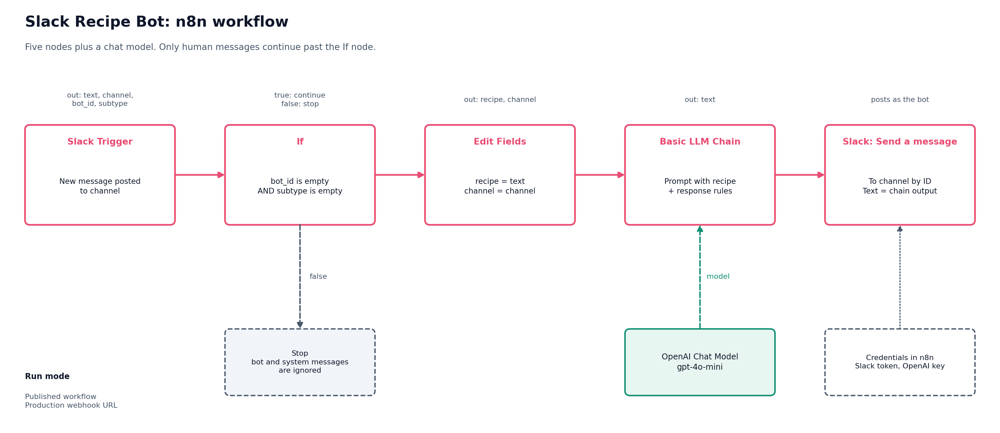

# Slack Recipe Bot — AI Automation with n8n and OpenAI

**Ask for a recipe in Slack. Get an AI-generated ingredient list in the same channel.**

A Slack-native assistant built with n8n and OpenAI. A user posts a dish name in a Slack channel; n8n filters bot/system events, sends the recipe request to an LLM, and posts the response back to the originating channel.

> This repository is only for the Slack Recipe Bot. It does not contain the separate student-enrollment ETL, Google Sheets/Gmail, or Python/Pandas projects.

## Architecture





## Workflow



1. **Slack Trigger** receives a channel message through Slack Events API.
2. **If** allows messages with empty `bot_id` and `subtype` to continue, filtering bot and system messages.
3. **Edit Fields** captures the message text as `recipe` and retains the original `channel` ID.
4. **Basic LLM Chain**, connected to an **OpenAI Chat Model**, generates an ingredient list or a clarification response.
5. **Slack: Send a message** posts the result to the original channel.

## Example

**User:** `Paneer Butter Masala`

**Bot:** a short bulleted ingredient list with approximate quantities for four servings.

For greetings such as `hello`, the bot asks which dish the user wants. For unclear text, it returns a polite retry message. Ingredients and quantities are model-generated and should be checked for accuracy, allergies, and dietary needs.

## Technology stack

| Component | Purpose |
|---|---|
| n8n | Workflow orchestration |
| Slack Events API / Slack Trigger | Receive channel messages |
| If | Filter bot and system messages |
| Edit Fields | Preserve recipe text and channel ID |
| Basic LLM Chain | Apply response instructions |
| OpenAI Chat Model | Generate the response (model configured in the workflow) |
| Slack Send a Message | Reply in the originating channel |

## Repository structure

```text
n8n-slack-recipe-bot/
├── README.md
├── flows/
│   └── n8n/
│       ├── README.md
│       └── slack-recipe-bot.json
├── docs/
│   ├── 07-slack-recipe-bot-architecture.md
│   ├── 08-slack-recipe-bot-workflow-design.md
│   ├── 09-slack-recipe-bot-setup-and-operations.md
│   └── 10-slack-recipe-bot-troubleshooting.md
├── images/
│   ├── slack-recipe-bot-architecture.png
│   ├── slack-recipe-bot-workflow.png
│   ├── slack-recipe-bot-sequence.png
│   └── slack-recipe-bot-input-handling.png
└── evidence/
    └── slack-recipe-bot/
        ├── README.md
        ├── n8n-workflow-canvas.png
        └── slack-ingredient-list-reply.png
```

## Getting started

1. Review [setup and operations](docs/09-slack-recipe-bot-setup-and-operations.md).
2. Create/configure your Slack app and n8n Slack/OpenAI credentials.
3. Import `flows/n8n/slack-recipe-bot.json` or recreate the workflow using the [workflow design](docs/08-slack-recipe-bot-workflow-design.md).
4. Select your own credentials and configure the Slack channel to monitor.
5. Configure Slack Event Subscriptions with the n8n Production URL, turn Socket Mode off, and publish the workflow.
6. Test recipe, greeting, and unclear-input scenarios; inspect n8n Executions.

The JSON in this package is a **sanitized import template**. Credentials are intentionally not embedded, and the channel is a placeholder. Select your own credentials and configure the channel after import. Node labels/settings can vary slightly across n8n versions.

## Documentation

- [Architecture](docs/07-slack-recipe-bot-architecture.md)
- [Workflow design](docs/08-slack-recipe-bot-workflow-design.md)
- [Setup and operations](docs/09-slack-recipe-bot-setup-and-operations.md)
- [Troubleshooting](docs/10-slack-recipe-bot-troubleshooting.md)
- [Workflow export notes](flows/n8n/README.md)
- [Evidence screenshots](evidence/slack-recipe-bot/README.md)

## Security

- Store Slack bot tokens and OpenAI API keys in n8n Credentials.
- Never commit secrets, `.env` files, or unredacted screenshots.
- Use a test channel and review the messages sent to the AI provider.
- The public workflow uses a placeholder channel ID; configure your own channel after importing.

## Known limitations and future work

- Ingredient quantities are approximate and AI-generated.
- Greeting and unclear-input handling is prompt-based, not guaranteed classification.
- Duplicate-event/idempotency handling is not implemented in this basic version.
- Consider thread replies, serving-size options, deterministic input validation, event deduplication, and richer Slack Block Kit output as future enhancements.

## Project

Repository: [ksmurari1/n8n-slack-recipe-bot](https://github.com/ksmurari1/n8n-slack-recipe-bot)
