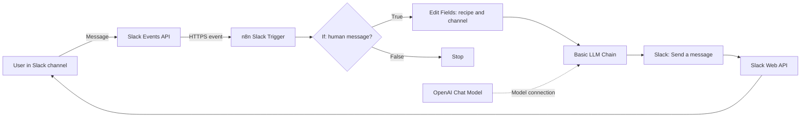
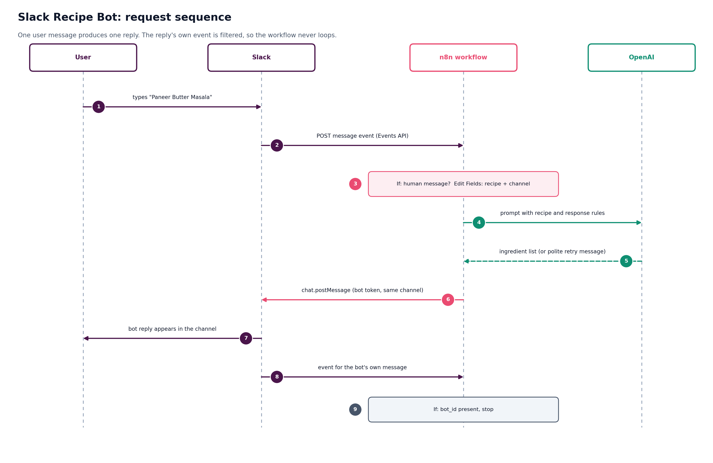
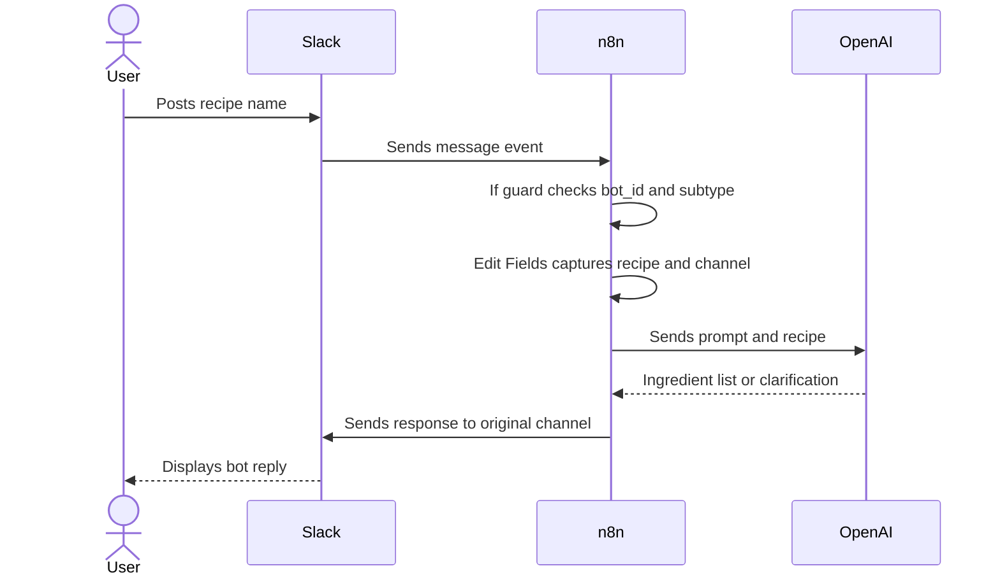

# Slack Recipe Bot: architecture

This document describes the components, message flow, Slack/n8n connection, and reliability and security considerations for the Slack Recipe Bot.

## System context

## Components

| Component | Responsibility | Notes |
|---|---|---|
| Slack workspace/channel | User interface for requests and replies | Use a dedicated channel for testing |
| Slack app and bot user | Identity, permissions, event subscriptions | Install the app and invite the bot |
| Slack Events API | Delivers channel message events | Requires a reachable HTTPS Request URL |
| Slack Trigger | Starts the n8n workflow | Configure the channel and Slack credential |
| If node | Filters bot/system events | Current guard checks `bot_id` and `subtype` are empty |
| Edit Fields | Captures message text and channel ID | Channel ID must survive through the AI chain |
| Basic LLM Chain | Applies recipe response rules | Connected to the OpenAI Chat Model |
| OpenAI Chat Model | Generates the response | The model is selected in the n8n workflow; confirm the configured model in your instance |
| Slack Send a Message | Posts the result | Uses the original channel ID |
| n8n Credentials | Stores connection secrets | Never commit tokens or API keys |

## Request sequence

## Slack event configuration

The documented setup uses Slack Event Subscriptions with the n8n Slack Trigger Request URL. Socket Mode is off.

- Subscribe to `message.channels` for public channels.
- Private channels may require `message.groups` and corresponding scopes.
- Typical bot scopes for public channels include `channels:history`, `channels:read`, and `chat:write`; verify current Slack requirements for your workspace and trigger configuration.
- Invite the bot to the channel it should read and reply in.
- Configure the **Production URL** for normal operation after publishing the workflow. Use the **Test URL** only during a test-listener session.

## Loop prevention

A bot's own reply may produce another Slack message event. The If node checks that `bot_id` and `subtype` are empty and only the true branch continues. This prevents common bot/system messages from invoking the LLM again. It is a basic filter, not full event deduplication.

## Security and reliability

- Keep bot tokens and API keys in n8n Credentials.
- Avoid exposing production webhook URLs, personal messages, or workspace identifiers in screenshots.
- Inspect execution logs for failures and avoid retaining unnecessary sensitive data.
- Consider duplicate-event protection, rate limiting, and deterministic input validation before production use.

## Related documents

- [Workflow design](08-slack-recipe-bot-workflow-design.md)
- [Setup and operations](09-slack-recipe-bot-setup-and-operations.md)
- [Troubleshooting](10-slack-recipe-bot-troubleshooting.md)
