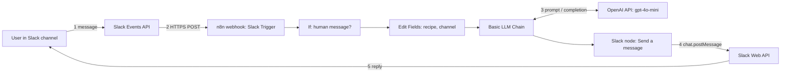
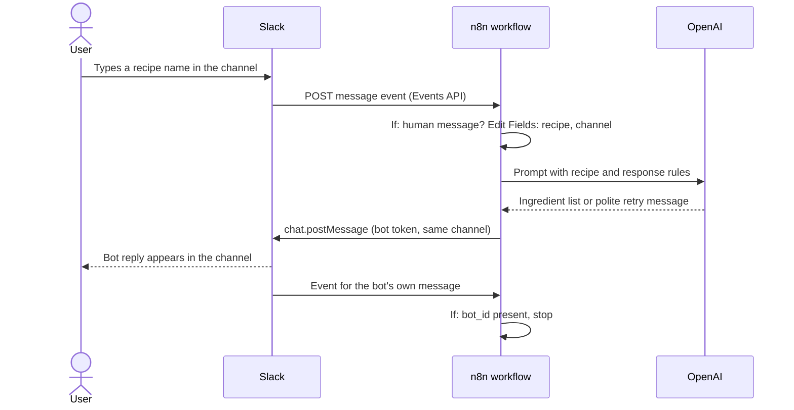

# Slack Recipe Bot: architecture

This document describes how the Slack Recipe Bot is put together: the components, how a message travels through them, how Slack and n8n are connected, and the security and reliability considerations.

The bot is a chat assistant that lives inside Slack. A user types the name of a dish in a channel, an LLM works out the products and ingredients needed to make it, and the bot replies with the list in the same channel.

## System context

## Components

| Component | Responsibility | Technology |
|---|---|---|
| Slack workspace and channel | Where users type recipe names and read replies | Slack |
| Slack app (bot user) | Identity of the bot, permission scopes, event subscription | Slack app with a bot token |
| Slack Events API | Delivers `message.channels` events to a public HTTPS URL | Slack platform |
| n8n workflow | Orchestrates filtering, field mapping, the LLM call and the reply | n8n, self-hosted on a VPS |
| LLM | Produces the ingredient list or a polite retry message | OpenAI `gpt-4o-mini` through the OpenAI Chat Model node |
| Slack Web API | Accepts the bot's reply (`chat.postMessage`) | Slack platform |
| Credential store | Holds the Slack bot token and the OpenAI API key | n8n credentials |
| Executions log | Per-run record of inputs, outputs and errors | n8n Executions tab |

## Request sequence

The last two steps matter: the bot's own reply is also a message in the channel, so Slack sends an event for it. The `If` node recognises it as a bot message and ends the run, which prevents an infinite loop.

## Slack integration model

The n8n Slack Trigger node receives events through a webhook. That determines how the Slack app must be configured:

- **Events API with a Request URL.** Event Subscriptions are enabled and point at the n8n webhook URL. Slack verifies the URL with a challenge request and shows it as verified.
- **Socket Mode is off.** With Socket Mode on, Slack delivers events over a websocket and ignores the Request URL, so the n8n webhook never receives anything.
- **Bot event:** `message.channels` (public channels). Private channels additionally need `message.groups`.
- **Bot token scopes:** `channels:history` (read messages), `channels:read` (list channels), `chat:write` (post replies). Private channels additionally need `groups:history` and `groups:read`.
- **Channel membership.** The bot only sees channels it has been invited to.

### Test URL and production URL

n8n exposes two webhook URLs for the Slack Trigger node:

| URL | Behaviour | Use for |
|---|---|---|
| Test URL (`/webhook-test/...`) | Answers only while the editor is listening, and only for one event | Inspecting live data on the canvas |
| Production URL (`/webhook/...`) | Answers continuously while the workflow is published | Normal operation |

Slack's Request URL must match the mode in use. A published workflow and a test listener cannot run at the same time for this trigger, so day-to-day verification is done by posting in Slack and reading the **Executions** tab.

## Deployment

- n8n runs self-hosted on a VPS and is reachable from the internet over HTTPS, which Slack requires for event delivery.
- The instance is configured with its public base URL (the `WEBHOOK_URL` setting), so the webhook URLs shown in the editor are the real public ones rather than `localhost`.
- The workflow is **published** so that the production webhook is live. Changes take effect for live traffic only after publishing again.

## Security and data handling

- **Secrets stay in credentials.** The Slack bot token and the OpenAI API key are stored in n8n credentials. They are never pasted into node parameters, and exported workflow JSON contains credential references, not secret values.
- **Least privilege.** The Slack app requests only the scopes it needs, and the bot is a member of a single test channel.
- **Request authenticity.** The Slack Trigger node recommends configuring a Slack signing secret so n8n can verify that requests really come from Slack. This is a recommended hardening step for production use.
- **Third-party processing.** The text of messages that reach the LLM chain is sent to the OpenAI API. Use a dedicated channel so that ordinary conversation is not forwarded.
- **Retention.** n8n stores execution data according to the instance's retention settings. Messages processed by the workflow appear in the Executions log.

## Reliability and cost considerations

- **One LLM call per human message.** Every message in the watched channel is processed, so a dedicated recipes channel keeps cost predictable.
- **Loop protection.** The `If` node drops messages with a `bot_id` or a `subtype` (joins, file shares, edits) before any LLM call is made.
- **Delivery retries.** Slack may retry an event if the endpoint is slow or unavailable. The workflow does not de-duplicate events today. De-duplication by event ID is listed under future improvements.
- **Probabilistic handling of unclear input.** The prompt tells the model how to respond to greetings and unrecognisable text. This works well in practice but is not a hard guarantee. A deterministic pre-check is listed under future improvements.
- **Not nutritional or allergy advice.** Ingredient quantities are approximate and generated by a language model.

## Related documents

- [Workflow design](08-slack-recipe-bot-workflow-design.md)
- [Setup and operations](09-slack-recipe-bot-setup-and-operations.md)
- [Troubleshooting](10-slack-recipe-bot-troubleshooting.md)
