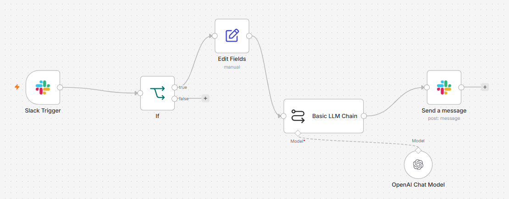
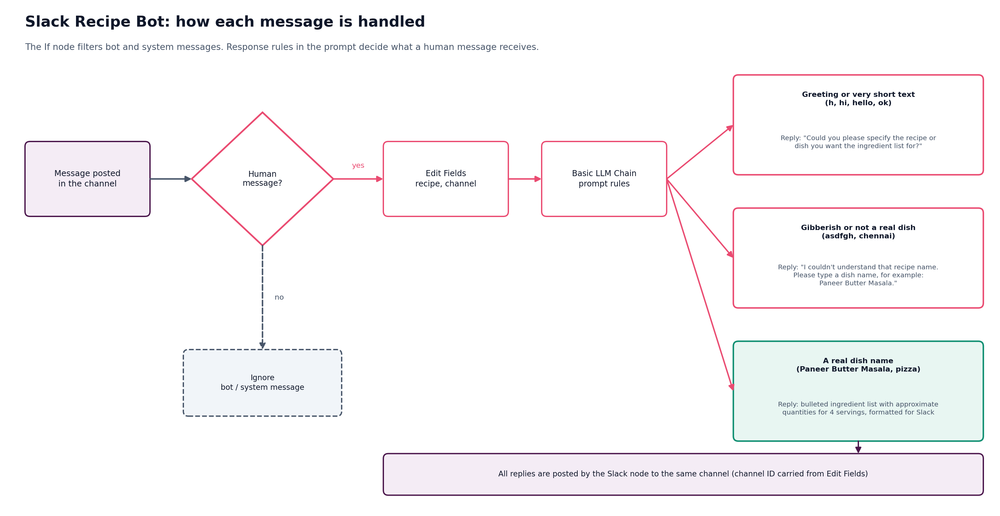
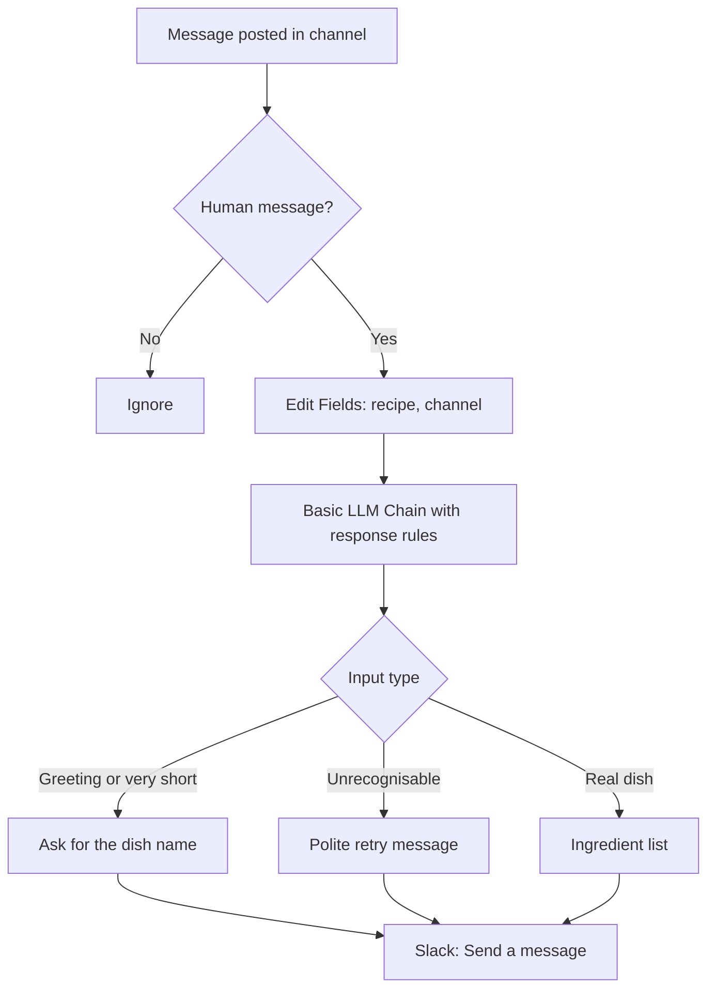
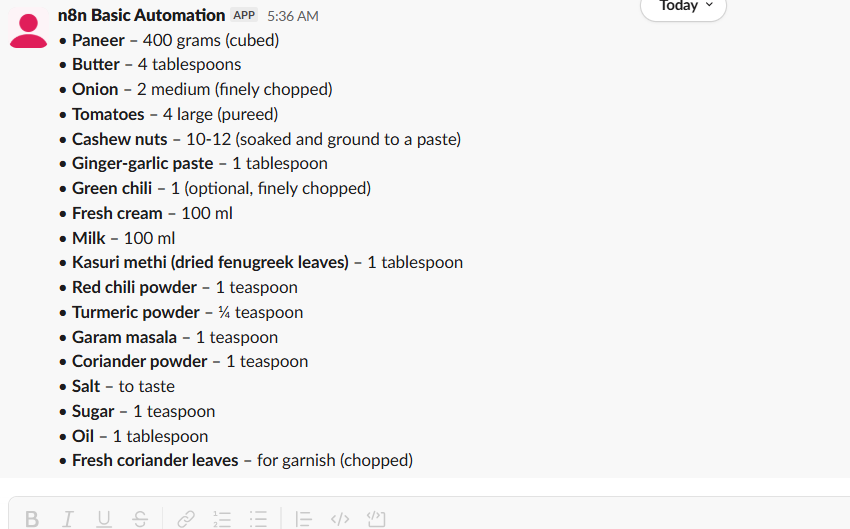

# Slack Recipe Bot: workflow design

This document describes the n8n workflow node by node, the prompt that drives the LLM, how each kind of input is handled, and the reasoning behind the main design choices.


The workflow as built in n8n:



## Workflow summary

| # | Node | Type | Purpose |
|---|---|---|---|
| 1 | Slack Trigger | Trigger | Starts a run when a message is posted in the watched channel |
| 2 | If | Flow control | Lets only human messages through |
| 3 | Edit Fields | Data mapping | Captures the recipe name and the channel ID |
| 4 | Basic LLM Chain | AI | Generates the ingredient list or a polite retry message |
| 4a | OpenAI Chat Model | AI model | `gpt-4o-mini`, attached to the chain |
| 5 | Slack: Send a message | Action | Posts the answer to the same channel |

## Node configuration

### 1. Slack Trigger

| Setting | Value |
|---|---|
| Credential | Slack API credential holding the bot token |
| Trigger On | New Message Posted to Channel |
| Watch Whole Workspace | Off |
| Channel to Watch | By ID (the channel ID of the test channel) |

Selecting the channel by ID is stable and does not depend on the channel list loading in the editor.

Useful output fields: `text` (the message), `channel` (the channel ID), `bot_id` and `subtype` (present on bot and system messages).

### 2. If (loop and noise guard)

Both conditions must be true (AND):

| Value 1 | Operator |
|---|---|
| `{{ $json.bot_id }}` | String: is empty |
| `{{ $json.subtype }}` | String: is empty |

- Only the **true** output is connected. Bot messages, joins, file shares and edits end the run.
- Without this node the bot's own reply would trigger the workflow again.

### 3. Edit Fields (Manual Mapping)

| Field | Type | Value (Expression mode) |
|---|---|---|
| `recipe` | String | `{{ $json.text }}` |
| `channel` | String | `{{ $json.channel }}` |

The `channel` field is kept here because the Basic LLM Chain output contains only the generated text, and the final node needs the channel ID.

### 4. Basic LLM Chain

| Setting | Value |
|---|---|
| Source for Prompt | Define below |
| Prompt | See below (Expression mode) |
| Model | OpenAI Chat Model, `gpt-4o-mini` |

#### Prompt

```text
The user typed this in Slack: {{ $json.recipe }}

Follow these rules in order:

1. If the text is a greeting, a single letter, or a very short message that is not a dish (for example: h, hi, hello, hey, ok, thanks), reply only with: "Could you please specify the recipe or dish you want the ingredient list for?"

2. If the text is gibberish or is clearly not the name of a real dish or recipe (for example: asdfgh, chennai), reply only with: "I couldn't understand that recipe name. Please type a dish name, for example: Paneer Butter Masala."

3. Otherwise, list all the products and ingredients needed to make that dish. Return a clear bulleted list with approximate quantities (for 4 servings). Keep it short and practical.
Format for Slack: use single asterisks for bold, "•" for bullets, and no markdown headings or double asterisks.
```

Prompt design notes:

- **Explicit, ordered rules** give the model a single place to decide between the three outcomes.
- **Fixed reply sentences** for the two non-recipe cases keep the bot's wording consistent.
- **Slack formatting instructions** matter because Slack uses its own markup: bold is `*text*`, not `**text**`. Without the instruction, double asterisks appear literally in the channel.
- **Approximate quantities for 4 servings** give a practical shopping list while keeping the answer short.

### 5. Slack: Send a message

| Setting | Value |
|---|---|
| Resource / Operation | Message / Send |
| Send Message To | Channel, By ID (Expression): `{{ $('Edit Fields').item.json.channel }}` |
| Message Type | Simple Text Message |
| Message Text (Expression) | `{{ $json.text }}` |
| Option: Include Link to Workflow | Off |

Turning off *Include Link to Workflow* removes the "Automated with this n8n workflow" footer so the reply looks like a normal bot message.

## Input handling





| Input | Result |
|---|---|
| `Paneer Butter Masala` | Bulleted ingredient list with approximate quantities for 4 servings |
| `pizza` | Bulleted ingredient list |
| `h`, `hi`, `hello` | "Could you please specify the recipe or dish you want the ingredient list for?" |
| `asdfgh`, `chennai` | "I couldn't understand that recipe name. Please type a dish name, for example: Paneer Butter Masala." |
| Message posted by the bot itself | No run beyond the `If` node |
| Join, file share or edited message | No run beyond the `If` node |



## Design decisions

| Decision | Reason |
|---|---|
| Webhook (Events API) instead of Socket Mode | The n8n Slack Trigger node works over a webhook; Socket Mode would bypass it |
| `If` node before the LLM | Prevents reply loops and avoids paying for LLM calls on bot and system messages |
| Channel ID carried through Edit Fields | The chain output does not include it, and replying to the originating channel keeps the interaction in one place |
| Channel selected by ID | Stable and independent of the channel list loading in the editor |
| Response rules in the prompt | Fast to build and easy to adjust; handles greetings and gibberish without extra nodes |
| Slack-specific formatting in the prompt | Produces clean bold text and bullets without a Code node |
| Simple Text Message in the Slack node | The reply is plain text with Slack markup, so no Block Kit is needed |

### Alternatives considered

- **Code node to reformat the answer.** Useful for strict formatting, but the prompt already yields clean Slack markup, so it was left out.
- **Deterministic input check before the LLM** (for example a length or dictionary check in the `If` node). It would make greeting handling fully predictable and save tokens, at the cost of more rules to maintain.
- **Slash command (`/recipe`) instead of reading every channel message.** It would remove the need to filter chatter and make the trigger explicit, but requires a different Slack setup and a different trigger.

## Future improvements

- Reply in a thread to keep the channel tidy.
- Add a servings parameter (for example `Paneer Butter Masala for 6`).
- Add a deterministic pre-check in the `If` node for greetings and very short text.
- De-duplicate retried events by event ID.
- Configure the Slack signing secret on the trigger.
- Use structured output (an output parser) and Slack Block Kit for richer formatting.
- Rate limiting or per-user cooldowns to control cost.

## Related documents

- [Architecture](07-slack-recipe-bot-architecture.md)
- [Setup and operations](09-slack-recipe-bot-setup-and-operations.md)
- [Troubleshooting](10-slack-recipe-bot-troubleshooting.md)
